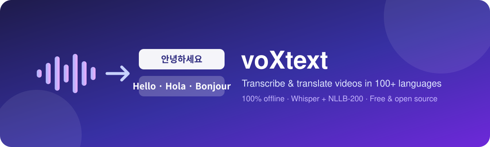
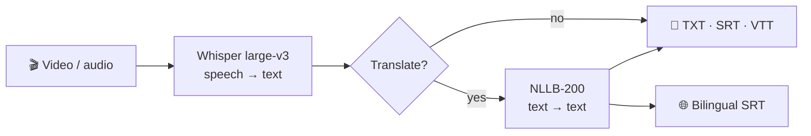

<div align="center">



# voXtext

**Free, private, offline subtitles for any video. Transcribe speech in 100 languages and translate it into 98, all on your own computer.**

[](LICENSE)
[](https://www.python.org/downloads/)
[](#-quick-start)
[](#-privacy)
[](#-gpu-acceleration)

[Quick start](#-quick-start) · [Features](#-features) · [Usage](#-usage) · [Languages](#-supported-languages) · [FAQ](#-faq--troubleshooting)

</div>

---

##  Why this exists

Online transcription services cap file sizes, charge per minute, and require you to upload private recordings to someone else's server. voXtext does the whole job locally: drop in a two-hour lecture, a Korean drama episode or a family video, choose the spoken language and the language you want, and get ready-to-use subtitle files back. No account, no upload, no limits.

##  Features

- **Any language → any language.** Korean → English, Japanese → Spanish, Arabic → French… Translation goes directly between the two languages, without a detour through English.
- **Fully offline.** After a one-time model download, it works with no internet at all.
- **Handles huge files.** Audio is streamed straight from the video, and silent stretches are skipped automatically.
- **Player-ready output.** Files are named like `movie.ko.srt` and `movie.en.srt`, so VLC, MPV and most players load them automatically.
- **Bilingual subtitles.** One SRT with the original line and its translation together, which is great for language learners.
- **Batch mode.** Point it at a folder and every video inside gets processed.
- **Two ways to use it.** A clean browser-based app for everyone, plus a command line for power users and automation.
- **Fast on NVIDIA GPUs, still works on any CPU.** If the GPU can't be used, it switches to CPU automatically instead of crashing.

##  How it works



| Step | Model | What it does |
|---|---|---|
| Transcription | [Whisper large-v3](https://github.com/openai/whisper) via [faster-whisper](https://github.com/SYSTRAN/faster-whisper) | Converts speech to timed text in the original language |
| Translation | [NLLB-200](https://ai.meta.com/research/no-language-left-behind/) via [CTranslate2](https://github.com/OpenNMT/CTranslate2) | Translates each subtitle line between 200 languages |
| Interface | [Gradio](https://www.gradio.app/) | The local web app that opens in your browser |

##  Quick start

### Requirements

- **Python 3.10 or newer** ([download](https://www.python.org/downloads/)). On Windows, tick **"Add Python to PATH"** during installation.
- About **12 GB of free disk space** for models (some of it is temporary download cache)
- **8 GB of RAM** or more
- *Optional:* an NVIDIA GPU with 6 GB+ VRAM for much faster processing

### 1. Download

```bash
git clone https://github.com/VaskarChakma/voXtext.git
cd voXtext
```

Or click **Code → Download ZIP** on this page and unzip it.

### 2. Set up (once, needs internet)

| Windows | macOS / Linux |
|---|---|
| Double-click **`setup_windows.bat`** | `chmod +x *.sh && ./setup.sh` |

This installs everything into a private `.venv` folder and downloads the models. It takes a while the first time, since the models are several gigabytes.

### 3. Run

| Windows | macOS / Linux |
|---|---|
| Double-click **`start_windows.bat`** | `./start.sh` |

Your browser opens at **http://127.0.0.1:7860**. That address only exists on your computer, so nobody else can see it.

##  Usage

### Web app

1. **Add your video.** Upload it, or use the *File / folder path* tab for very large files and whole folders (nothing gets copied, and subtitles are saved next to the originals).
2. **Spoken language:** pick the language of the video, or leave it on *Auto-detect*.
3. **Translate to:** pick the language you want, or *No translation*.
4. **Output files:** choose any of `txt`, `timestamps`, `srt`, `vtt` and `bilingual`.
5. Press **▶ Start**, then download the results or read them in the preview tabs.

>  **Tip:** Picking the spoken language yourself (instead of auto-detect) is slightly faster and avoids mistakes on videos that open with music or silence.

### Command line

Activate the environment first: `.venv\Scripts\activate` (Windows) or `source .venv/bin/activate` (macOS/Linux).

```bash
# Transcribe only, auto-detecting the language
python cli.py interview.mp4

# Korean video -> English subtitles
python cli.py lecture.mp4 --source ko --target en

# A whole folder of Japanese videos -> Spanish, skipping ones already done
python cli.py D:/Videos/anime --source ja --target es --skip-existing

# Pick formats and an output folder
python cli.py talk.mkv -t fr -f srt,vtt,bilingual -o ./subtitles

# Help with names and jargon
python cli.py keynote.mp4 -s en -t ko --prompt "Kubernetes, PostgreSQL, Jensen Huang"

# See every supported language
python cli.py --list-languages
```

Languages can be given as codes (`ko`) or names (`Korean`).

### Output files

For `lecture.mp4` (Korean) translated into English:

| File | Contents |
|---|---|
| `lecture.ko.txt` / `lecture.en.txt` | Clean transcript, one line per sentence |
| `lecture.ko_timestamps.txt` | Transcript with `[00:12:34]` markers |
| `lecture.ko.srt` / `lecture.en.srt` | Subtitles for video players and editors |
| `lecture.ko.vtt` / `lecture.en.vtt` | Subtitles for web players and YouTube |
| `lecture.ko-en.srt` | Bilingual subtitles: original on top, translation below |

##  Supported languages

**Transcription (100):** Afrikaans, Albanian, Amharic, Arabic, Armenian, Assamese, Azerbaijani, Bashkir, Basque, Belarusian, Bengali, Bosnian, Breton, Bulgarian, Burmese, Cantonese, Catalan, Chinese, Croatian, Czech, Danish, Dutch, English, Estonian, Faroese, Finnish, French, Galician, Georgian, German, Greek, Gujarati, Haitian Creole, Hausa, Hawaiian, Hebrew, Hindi, Hungarian, Icelandic, Indonesian, Italian, Japanese, Javanese, Kannada, Kazakh, Khmer, Korean, Lao, Latin, Latvian, Lingala, Lithuanian, Luxembourgish, Macedonian, Malagasy, Malay, Malayalam, Maltese, Maori, Marathi, Mongolian, Nepali, Norwegian, Norwegian Nynorsk, Occitan, Pashto, Persian, Polish, Portuguese, Punjabi, Romanian, Russian, Sanskrit, Serbian, Shona, Sindhi, Sinhala, Slovak, Slovenian, Somali, Spanish, Sundanese, Swahili, Swedish, Tagalog, Tajik, Tamil, Tatar, Telugu, Thai, Tibetan, Turkish, Turkmen, Ukrainian, Urdu, Uzbek, Vietnamese, Welsh, Yiddish, Yoruba.

**Translation (98):** all of the above except Breton, Hawaiian and Latin, plus **Chinese (Traditional)** as an extra output language.

Run `python cli.py --list-languages` for the full table with codes.

> Accuracy varies by language. Widely spoken languages (English, Korean, Japanese, Chinese, Spanish, French, German and similar) give excellent results; less-resourced languages work but make more mistakes.

##  Choosing models

**Speech model (Whisper)**

| Model | Accuracy | Speed | Size |
|---|---|---|---|
| `large-v3` *(default)* | Best | Slowest | ~3 GB |
| `large-v3-turbo` | Very good | Several times faster | ~1.6 GB |
| `medium` | Good | Faster | ~1.5 GB |
| `small` | Fair | Fast | ~0.5 GB |

**Translation model (NLLB-200)**

| Model | Quality | Size |
|---|---|---|
| `nllb-600m` | Good | ~1.2 GB |
| `nllb-1.3b` *(default)* | Better | ~2.7 GB |
| `nllb-3.3b` | Best | ~6.6 GB, needs a strong GPU |

Add more models any time (while online):

```bash
python download_models.py --whisper large-v3-turbo --nllb nllb-600m
```

Then pick them under **Advanced settings** in the app, or with `--model` / `--nllb` on the command line.

### Rough speed for a 1-hour video

| Hardware | Transcription (`large-v3`) | Translation (`nllb-1.3b`) |
|---|---|---|
| Modern NVIDIA GPU | ~3–6 min | under a minute |
| Typical laptop CPU | ~30–90 min | a few minutes |

If CPU is too slow, `large-v3-turbo` is the best trade-off.

##  GPU acceleration

On machines with an NVIDIA GPU, setup installs the required CUDA libraries automatically and the app uses the GPU without any configuration. To install them manually:

```bash
pip install nvidia-cublas-cu12 "nvidia-cudnn-cu12==9.*"
```

If the GPU can't be used for any reason, you'll see a warning and processing continues on the CPU. Apple Silicon Macs run on the CPU.

##  Privacy

Everything runs on your machine. The app only uses the internet during setup, to download the models; after that, the start scripts force offline mode. The web interface listens on `127.0.0.1`, so it can't be reached from other devices, and analytics are switched off.

##  FAQ & troubleshooting

<details>
<summary><b>"Library cublas64_12.dll is not found"</b></summary>

The NVIDIA libraries are missing. Run `pip install nvidia-cublas-cu12 "nvidia-cudnn-cu12==9.*"` inside the activated environment. The app will fall back to CPU in the meantime.
</details>

<details>
<summary><b>"Translation model isn't installed yet"</b></summary>

Run `python download_models.py --nllb nllb-1.3b` once with internet. Converting the model needs about 8 GB of RAM.
</details>

<details>
<summary><b>The same sentence repeats many times</b></summary>

Rare, but it can happen on long silences or music. Try `large-v3-turbo` or `medium`, set the spoken language explicitly, or add a short hint.
</details>

<details>
<summary><b>Names or technical terms are misspelled</b></summary>

Type them into the **Hint** box (or `--prompt`), separated by commas. This noticeably improves proper nouns.
</details>

<details>
<summary><b>Out of memory on the GPU</b></summary>

Choose a smaller model (`large-v3-turbo`, `nllb-600m`), or select **Device → cpu** under Advanced settings.
</details>

<details>
<summary><b>Can I free up disk space after setup?</b></summary>

Yes. The original translation model download is cached in your Hugging Face cache folder (`~/.cache/huggingface`, or `C:\Users\<you>\.cache\huggingface` on Windows). Once setup finishes, you can delete the `models--facebook--nllb-*` folder there; the converted copy in `models/` is all the app needs.
</details>

## Project structure

```
├── app.py               Web interface
├── cli.py               Command-line interface
├── download_models.py   One-time model download / conversion
├── core/
│   ├── engine.py        Pipeline: transcribe → translate → write files
│   ├── transcriber.py   Whisper speech-to-text
│   ├── translator.py    NLLB-200 translation
│   ├── languages.py     Language names and code mappings
│   ├── subtitles.py     TXT / SRT / VTT writers
│   └── compat.py        Fixes for library quirks
├── setup_windows.bat    start_windows.bat
└── setup.sh             start.sh
```

##  Contributing

Issues and pull requests are welcome. See [CONTRIBUTING.md](CONTRIBUTING.md). If this project helped you, a ⭐ on GitHub helps others find it.

##  License

The code in this repository is released under the [MIT License](LICENSE).

The AI models are downloaded separately and keep their own licenses:

- **Whisper** (OpenAI): MIT License
- **NLLB-200** (Meta): [CC BY-NC 4.0](https://creativecommons.org/licenses/by-nc/4.0/), which means **non-commercial use only**. For commercial projects, use transcription only, or replace the translation model with a commercially licensed one.

##  Acknowledgements

Built on the shoulders of [OpenAI Whisper](https://github.com/openai/whisper), [faster-whisper](https://github.com/SYSTRAN/faster-whisper), [Meta's No Language Left Behind](https://ai.meta.com/research/no-language-left-behind/), [CTranslate2](https://github.com/OpenNMT/CTranslate2), [Hugging Face Transformers](https://github.com/huggingface/transformers) and [Gradio](https://www.gradio.app/).
